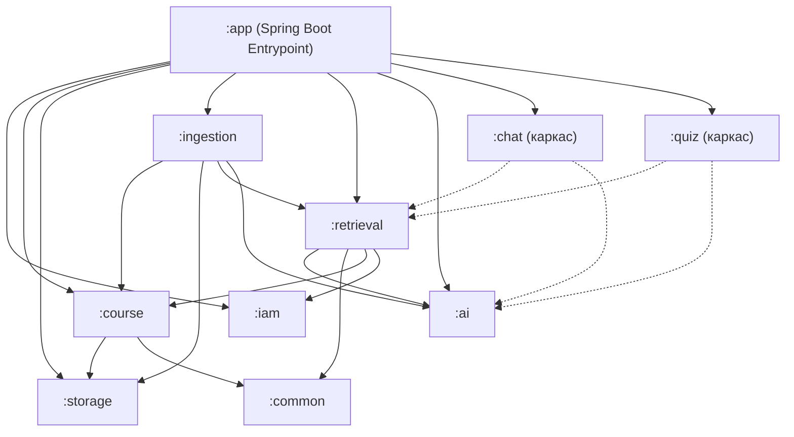
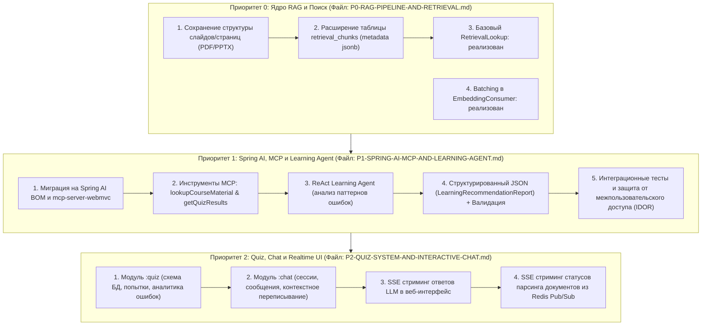

# StudyMate: Общий технический аудит и матрица готовности проекта

> **Цель проекта:** Создание платформы типа NotebookLLM для студентов университетов (в частности, FIT ČVUT), позволяющей загружать учебные материалы (PDF, PPTX лекции, семинары), индексировать их в PostgreSQL с расширением `pgvector` (HNSW индекс) и вести интерактивный RAG-диалог по материалам курса или конкретного документа, а также генерировать персонализированные тесты и анализировать слабые места студента с помощью автономного AI-агента.

> **Актуальность:** документ содержит исходный аудит проекта. Строка retrieval и его зависимости обновлены на 2026-11-05 после реализации базового поиска; статусы ingestion и chat обновлены на 2026-11-08 после реализации пакетного эмбеддинга и первого RAG-ответа по курсу. Оценки остальных модулей и архитектурные диаграммы относятся к исходному аудиту. Текущий HTTP-контракт поиска и реализация batching описаны в [P0-RAG-PIPELINE-AND-RETRIEVAL.md](P0-RAG-PIPELINE-AND-RETRIEVAL.md), HTTP-контракт chat — в разделе 2.0 [P2-QUIZ-SYSTEM-AND-INTERACTIVE-CHAT.md](P2-QUIZ-SYSTEM-AND-INTERACTIVE-CHAT.md).

---

## 1. Архитектурный срез кодовой базы

Проект реализован как модульный монолит на стеке:
- **Язык и среда:** Kotlin 2.0.20, JVM 21.
- **Фреймворк:** Spring Boot 3.3.4.
- **База данных:** PostgreSQL 16 с расширением `pgvector:pg16`.
- **Миграции и доступ к данным:** Liquibase, jOOQ 9.0 (генерация типобезопасных классов из схемы БД).
- **Очереди и кэш:** Apache Kafka 3.8.0, Redis 7 (Alpine).
- **Связь модулей:** In-process вызовы через API-интерфейсы + асинхронные события через Kafka.

### Структура модулей (`backend/modules/`)

---

## 2. Матрица готовности модулей

| Модуль | Назначение | Статус | Что реализовано | Что отсутствует / Требует доработки |
| :--- | :--- | :---: | :--- | :--- |
| **`:iam`** | Аутентификация и пользователи | **100%** | Регистрация, логин, JWT в HttpOnly cookies, сессии в БД, `Role` (USER, ADMIN), тесты. | Готово к интеграции. |
| **`:course`** | Управление курсами и материалами | **90%** | CRUD курсов, загрузка материалов, проверка квот пользователя (100MB), Tika валидация типов. | Заполнение `page_count`, учет структуры слайдов/страниц. |
| **`:storage`** | Хранилище бинарных файлов | **95%** | `LocalFileStorage` по путям `user_{id}/course_{id}/...`. | Поддержка S3/MinIO при переносе в облако. |
| **`:ingestion`** | Асинхронный конвейер обработки | **Базовый конвейер готов** | Kafka pipeline (Upload -> Parse -> Chunk -> Embed -> Index), идемпотентность, Redis трансляция статусов, последовательный эмбеддинг пакетами до 32 текстов, проверка количества векторов и одно итоговое событие, тесты пакетной обработки. | Сохранение номеров страниц/слайдов, SSE-контроллер для UI. |
| **`:retrieval`** | Векторная база и поиск | **Базовый поиск готов** | Таблица `retrieval_chunks`, HNSW индекс, атомарная переиндексация, `RetrievalLookup`, поиск по курсу и материалу с проверкой владельца, HTTP API, модульные и интеграционные тесты. | Гибридный поиск, реранкинг, метаданные страниц/слайдов и обработка длинных вопросов остаются дальнейшими этапами. |
| **`:ai`** | Интеграция с LLM и эмбеддингами | **40%** | Самописные клиенты для Ollama (bge-m3), Groq, Anthropic с ретраями. | **Spring AI не подключен**, нет поддержки MCP, нет ReAct-агента, нет валидации структурированного JSON. |
| **`:chat`** | RAG-диалог со студентом | **Первый RAG-ответ готов** | Один вопрос по курсу → `RetrievalLookup` → `RagChatPrompts` → `LlmClient`; полный JSON с ответом и источниками, строгий JSON-тип вопроса только для chat, обработка ошибок. Два тестовых класса: сервис и контроллер; в тестах контроллера есть один успешный сценарий с настоящим сервисом и промптами, мокированными retrieval/LLM и тестовым principal resolver. | История и таблицы чатов, поиск в рамках материала для chat, Query Rewriting, SSE, метаданные страниц и проверка корректности цитирования остаются отдельными этапами. |
| **`:quiz`** | Тестирование и оценка знаний | **0%** | Пустые папки с `.gitkeep`, один черновой промпт в `:ai`. | Схема БД квизов и попыток сдачи, логика начисления баллов, связка с материалами курса. |

---

## 3. Архитектурная карта приоритетов реализации

План разделен на три этапа по степени критичности. Уже реализованные пункты P0 отмечены на схеме:

---

## 4. Ссылки на детальные документы

- **[P0-RAG-PIPELINE-AND-RETRIEVAL.md](file:///Users/test/IdeaProjects/studymate/docs/P0-RAG-PIPELINE-AND-RETRIEVAL.md)** — Детальный план доработки RAG: слайдовый парсинг, схема `pgvector`, реализация `RetrievalService`, гибридный поиск (BM25 + Dense Vector), реранкинг и устранение узких мест в Kafka Ingestion.
- **[P1-SPRING-AI-MCP-AND-LEARNING-AGENT.md](file:///Users/test/IdeaProjects/studymate/docs/P1-SPRING-AI-MCP-AND-LEARNING-AGENT.md)** — Интеграция Spring AI, развертывание MCP сервера по протоколу JSON-RPC (HTTP/SSE), ReAct-агент, генерация рекомендаций, разграничение скоупов (User/Course), устойчивость к сбоям LLM.
- **[P2-QUIZ-SYSTEM-AND-INTERACTIVE-CHAT.md](file:///Users/test/IdeaProjects/studymate/docs/P2-QUIZ-SYSTEM-AND-INTERACTIVE-CHAT.md)** — Реализация модулей `quiz` и `chat` с нуля: схемы таблиц Liquibase, многошаговый диалог, цитаты со ссылками на слайды и потоковая передача данных (SSE).
