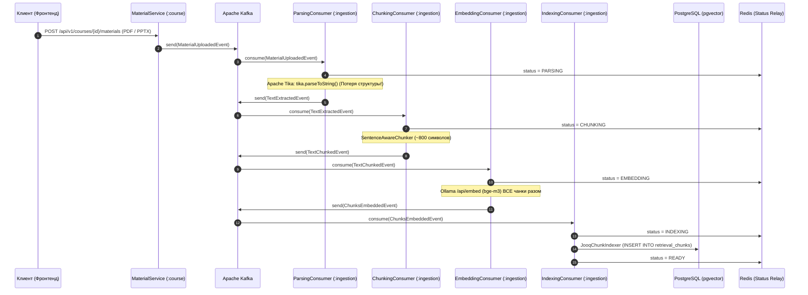

# План реализации P0: Ядро RAG и поисковый движок (Retrieval Engine)

> **Приоритет: P0 (Критический).** Без компонентов этого документа система RAG физически не может отвечать на вопросы, так как на текущий момент в бэкенде отсутствует логика извлечения (Retrieval) векторов из базы данных.

---

## 1. Анализ текущего RAG-конвейера

Текущий конвейер обработки файлов в модуле [`:ingestion`](file:///Users/test/IdeaProjects/studymate/backend/modules/ingestion) работает по асинхронной схеме через Kafka:



### Выявленные критические дефекты:
1. **Потеря страниц и слайдов:** в [`ParsingConsumer.kt#L45`](file:///Users/test/IdeaProjects/studymate/backend/modules/ingestion/src/main/kotlin/cz/cvut/fit/studymate/ingestion/internal/kafka/consumer/ParsingConsumer.kt#L45) вызывается `tika.parseToString(it)`. В результате весь документ становится единой неструктурированной строкой.
   - Поле `page_count` в таблице `materials` остается `null`.
   - Студент не может получить ответ вида: *«Это объяснялось на слайде 14 презентации Lecture03.pptx»*.
2. **Отсутствие метаданных в чанках:** в таблице `retrieval_chunks` нет поля `metadata jsonb`. Хранятся только `chunk_index` и плоский `chunk_text`.
3. **Риск падения по OOM / Timeout при эмбеддинге:** в [`EmbeddingConsumer.kt#L43`](file:///Users/test/IdeaProjects/studymate/backend/modules/ingestion/src/main/kotlin/cz/cvut/fit/studymate/ingestion/internal/kafka/consumer/EmbeddingConsumer.kt#L43) все чанки документа передаются в один HTTP-запрос в Ollama. Большой учебник на 300 страниц вызовет перегрузку Ollama.
4. **Полное отсутствие Retrieval API:** в модуле [`:retrieval`](file:///Users/test/IdeaProjects/studymate/backend/modules/retrieval) реализован только класс [`JooqChunkIndexer`](file:///Users/test/IdeaProjects/studymate/backend/modules/retrieval/src/main/kotlin/cz/cvut/fit/studymate/retrieval/internal/indexing/JooqChunkIndexer.kt). Нет ни одного репозитория, интерфейса или сервиса, выполняющего запрос `SELECT ... ORDER BY embedding <=> query_vector`.

---

## 2. Модернизация схемы БД (Liquibase)

Необходимо добавить расширенные метаданные чанка (номер слайда/страницы, заголовок секции, тип содержимого) и оптимизировать индексы.

### Миграция: `retrieval/src/main/resources/db/changelog/changes/002-add-chunk-metadata-and-fts.sql`

```sql
--liquibase formatted sql

--changeset studymate:retrieval-002-add-chunk-metadata-and-fts
-- 1. Добавляем метаданные в формате JSONB
ALTER TABLE retrieval_chunks 
ADD COLUMN metadata jsonb NOT NULL DEFAULT '{}'::jsonb;

-- 2. Добавляем полнотекстовый индекс для гибридного поиска (BM25 / Full-Text Search)
-- Используем конфигурацию 'simple', чтобы не ломать чешские и английские термины стеммингом
ALTER TABLE retrieval_chunks 
ADD COLUMN text_search_vector tsvector 
GENERATED ALWAYS AS (to_tsvector('simple', chunk_text)) STORED;

CREATE INDEX idx_retrieval_chunks_fts ON retrieval_chunks USING gin(text_search_vector);
CREATE INDEX idx_retrieval_chunks_metadata ON retrieval_chunks USING gin(metadata);

-- 3. Составной индекс для быстрой фильтрации по курсу и материалу
CREATE INDEX idx_retrieval_chunks_course_owner ON retrieval_chunks(course_id, owner_id);
```

---

## 3. Слайдо- и странично-ориентированный парсинг

Вместо `tika.parseToString(stream)` необходимо использовать структурированное извлечение через SAX-события или постраничный разбор.

### Модель структурной страницы (`PageContent`)

```kotlin
package cz.cvut.fit.studymate.ingestion.internal.parser

data class DocumentPage(
    val pageNumber: Int, // Номер слайда в PPTX или страницы в PDF (1-based)
    val text: String,
    val header: String? = null,
)

data class ParsedDocument(
    val pages: List<DocumentPage>,
    val totalPages: Int,
)
```

### Парсер на основе Apache Tika ContentHandler

В [`ParsingConsumer.kt`](file:///Users/test/IdeaProjects/studymate/backend/modules/ingestion/src/main/kotlin/cz/cvut/fit/studymate/ingestion/internal/kafka/consumer/ParsingConsumer.kt) парсинг разделяется по тегам страниц/слайдов:

```kotlin
@Component
internal class PageAwareDocumentParser {

    fun parse(stream: InputStream, mimeType: String): ParsedDocument {
        val parser = AutoDetectParser()
        val handler = ToTextContentHandler()
        val metadata = Metadata()
        val context = ParseContext()

        // Настройка для постраничного разделения через маркеры form feed '\f' или div
        parser.parse(stream, handler, metadata, context)
        val fullContent = handler.toString()

        // Tika разделяет страницы символом '\f' (form feed) для большинства PDF и PPTX документов
        val rawPages = fullContent.split('\u000C')
            .map { it.trim() }
            .filter { it.isNotBlank() }

        val pages = if (rawPages.isNotEmpty()) {
            rawPages.mapIndexed { index, content ->
                DocumentPage(pageNumber = index + 1, text = content)
            }
        } else {
            listOf(DocumentPage(pageNumber = 1, text = fullContent.trim()))
        }

        return ParsedDocument(pages = pages, totalPages = pages.size)
    }
}
```

> **Обновление `materials.page_count`:** в конце парсинга `ParsingConsumer` обновляет поле `page_count` в таблице `materials`, сохраняя точное количество слайдов/страниц.

---

## 4. Чанкинг с сохранением метаданных (Slide-Aware Chunking)

Для учебных презентаций слайд является атомарной смысловой единицей. Склеивание слайдов ломает контекст.

### Логика чанкинга:
1. Если слайд содержит $\le 1000$ символов (типичный слайд лекции) — он становится **одним чанком**.
2. Если слайд содержит большой объем текста (например, длинный листинг кода или конспект лекции) — применяется `SentenceAwareChunker`, но **строго внутри данного слайда**.
3. Метаданные каждого чанка включают:
   ```json
   {
     "pageNumber": 14,
     "materialTitle": "Lecture_03_Trees.pptx",
     "isSlide": true
   }
   ```

### Обновленные DTO событий

```kotlin
data class ChunkWithMetadataDto(
    val chunkIndex: Int,
    val text: String,
    val metadata: Map<String, Any>,
)

data class ChunkWithEmbeddingDto(
    val chunkIndex: Int,
    val text: String,
    val metadata: Map<String, Any>,
    val embedding: FloatArray,
)
```

---

## 5. Пакетная обработка в `EmbeddingConsumer` (Защита от OOM)

В [`EmbeddingConsumer.kt`](file:///Users/test/IdeaProjects/studymate/backend/modules/ingestion/src/main/kotlin/cz/cvut/fit/studymate/ingestion/internal/kafka/consumer/EmbeddingConsumer.kt) чанки разбиваются на подбатчи по 32 штуки:

```kotlin
private const val EMBEDDING_BATCH_SIZE = 32

fun handle(event: TextChunkedEvent) {
    if (processedEventsRepository.exists(event.eventId)) return

    try {
        updateStatus(event, MaterialStatus.EMBEDDING)
        
        // Батчинг для предотвращения перегрузки Ollama
        val allEmbeddings = mutableListOf<FloatArray>()
        val batches = event.chunks.chunked(EMBEDDING_BATCH_SIZE)
        
        for (batch in batches) {
            val texts = batch.map { it.text }
            val batchEmbeddings = runBlocking { embeddingClient.embed(texts) }
            allEmbeddings.addAll(batchEmbeddings)
        }

        val embeddedChunks = event.chunks.zip(allEmbeddings) { chunk, emb ->
            ChunkWithEmbeddingDto(chunk.chunkIndex, chunk.text, chunk.metadata, emb)
        }

        kafkaTemplate.send(
            kafkaTopics.chunksEmbedded,
            event.materialId.toString(),
            ChunksEmbeddedEvent(
                materialId = event.materialId,
                courseId = event.courseId,
                ownerId = event.ownerId,
                chunks = embeddedChunks,
            )
        ).get()

        processedEventsRepository.markProcessed(event.eventId)
    } catch (e: Exception) {
        fail(event, e)
    }
}
```

---

## 6. Реализация ядра поиска (Retrieval Service)

В модуль `:retrieval` добавляется полноценный поисковый сервис.

### Интерфейс `RetrievalLookup`

```kotlin
package cz.cvut.fit.studymate.retrieval.api

import java.util.UUID

data class SearchResultChunk(
    val chunkId: UUID,
    val materialId: UUID,
    val courseId: UUID,
    val chunkIndex: Int,
    val text: String,
    val metadata: Map<String, Any>,
    val similarityScore: Double, // 1.0 - cosine_distance
)

interface RetrievalLookup {
    /**
     * Поиск по всем материалам курса
     */
    suspend fun searchCourse(
        courseId: UUID,
        userId: UUID,
        query: String,
        limit: Int = 5,
        minSimilarity: Double = 0.5,
    ): List<SearchResultChunk>

    /**
     * Поиск внутри одного конкретного документа (PDF / PPTX)
     */
    suspend fun searchMaterial(
        materialId: UUID,
        courseId: UUID,
        userId: UUID,
        query: String,
        limit: Int = 5,
        minSimilarity: Double = 0.5,
    ): List<SearchResultChunk>
}
```

### Реализация векторного поиска через jOOQ и pgvector

```kotlin
package cz.cvut.fit.studymate.retrieval.internal.service

import com.fasterxml.jackson.databind.ObjectMapper
import com.fasterxml.jackson.module.kotlin.readValue
import com.pgvector.PGvector
import cz.cvut.fit.studymate.ai.api.EmbeddingClient
import cz.cvut.fit.studymate.retrieval.api.RetrievalLookup
import cz.cvut.fit.studymate.retrieval.api.SearchResultChunk
import org.jooq.DSLContext
import org.jooq.impl.DSL.*
import org.springframework.stereotype.Service
import java.util.UUID

@Service
internal class PgvectorRetrievalService(
    private val dsl: DSLContext,
    private val embeddingClient: EmbeddingClient,
    private val objectMapper: ObjectMapper,
) : RetrievalLookup {

    override suspend fun searchCourse(
        courseId: UUID,
        userId: UUID,
        query: String,
        limit: Int,
        minSimilarity: Double,
    ): List<SearchResultChunk> {
        val queryEmbedding = embeddingClient.embed(listOf(query)).first()
        return executeVectorSearch(
            filterCondition = field(name("course_id"), UUID::class.java).eq(courseId)
                .and(field(name("owner_id"), UUID::class.java).eq(userId)),
            queryVector = queryEmbedding,
            limit = limit,
            minSimilarity = minSimilarity,
        )
    }

    override suspend fun searchMaterial(
        materialId: UUID,
        courseId: UUID,
        userId: UUID,
        query: String,
        limit: Int,
        minSimilarity: Double,
    ): List<SearchResultChunk> {
        val queryEmbedding = embeddingClient.embed(listOf(query)).first()
        return executeVectorSearch(
            filterCondition = field(name("material_id"), UUID::class.java).eq(materialId)
                .and(field(name("course_id"), UUID::class.java).eq(courseId))
                .and(field(name("owner_id"), UUID::class.java).eq(userId)),
            queryVector = queryEmbedding,
            limit = limit,
            minSimilarity = minSimilarity,
        )
    }

    private fun executeVectorSearch(
        filterCondition: org.jooq.Condition,
        queryVector: FloatArray,
        limit: Int,
        minSimilarity: Double,
    ): List<SearchResultChunk> {
        val vectorLiteral = PGvector(queryVector).value
        
        // Оператор косинусного расстояния в pgvector: embedding <=> '[0.1, 0.2, ...]'
        val distanceField = field("embedding <=> {0}::vector", Double::class.java, vectorLiteral)
        val similarityField = field("1 - (embedding <=> {0}::vector)", Double::class.java, vectorLiteral)

        return dsl.select(
            field(name("id"), UUID::class.java),
            field(name("material_id"), UUID::class.java),
            field(name("course_id"), UUID::class.java),
            field(name("chunk_index"), Int::class.java),
            field(name("chunk_text"), String::class.java),
            field(name("metadata"), String::class.java),
            similarityField.`as`("similarity"),
        )
            .from(table(name("retrieval_chunks")))
            .where(filterCondition)
            .and(similarityField.ge(minSimilarity))
            .orderBy(distanceField.asc())
            .limit(limit)
            .fetch { record ->
                val metadataJson = record.get("metadata", String::class.java) ?: "{}"
                SearchResultChunk(
                    chunkId = record.get("id", UUID::class.java),
                    materialId = record.get("material_id", UUID::class.java),
                    courseId = record.get("course_id", UUID::class.java),
                    chunkIndex = record.get("chunk_index", Int::class.java),
                    text = record.get("chunk_text", String::class.java),
                    metadata = objectMapper.readValue(metadataJson),
                    similarityScore = record.get("similarity", Double::class.java),
                )
            }
    }
}
```

---

### Реализованный HTTP API поиска

**Статус на 2026-11-02:** контроллер находится в модуле `retrieval`, пакет `cz.cvut.fit.studymate.retrieval.internal.controller`.

```http
POST /api/v1/courses/{courseId}/search
Content-Type: application/json
Cookie: access_token=<JWT>

{
  "query": "Что означает атомарность транзакции?",
  "limit": 5
}
```

Путь обозначает поиск внутри конкретного курса, поэтому содержит `courses/{courseId}`. Он не определяет модуль реализации. Поле `limit` необязательно: по умолчанию используется 5. Идентификатор пользователя берется из проверенного JWT через `@AuthenticationPrincipal`, а не из тела запроса.

Контроллер вызывает `RetrievalLookup.searchCourse`. Реализация `RetrievalService` обрезает пробелы, проверяет вопрос и положительный лимит, затем существование курса и его владельца. После этого `EmbeddingClient` получает эмбеддинг вопроса, а `ChunkSearchRepository` ищет чанки по этому вектору с фильтрами `course_id` и `owner_id`.

Ответ `200` — JSON-массив объектов `SearchResultChunk` с полями `chunkId`, `materialId`, `chunkIndex`, `text`, `distance`. Результаты отсортированы по возрастанию косинусного расстояния; меньшая дистанция означает большую близость. При отсутствии проиндексированных фрагментов возвращается `[]`. Этот API возвращает фрагменты материалов; генерация ответа по найденным фрагментам — следующий этап RAG.

| Код | Причина | Тело |
| --- | --- | --- |
| 400 | Пустой вопрос, неположительный лимит, некорректный JSON или UUID курса | `ErrorResponse` с полем `message` |
| 403 | Курс принадлежит другому пользователю | `ErrorResponse` с полем `message` |
| 403 | Нет действительной cookie `access_token` | Ответ существующего Spring Security; тело может отсутствовать |
| 404 | Курс не существует | `ErrorResponse` с полем `message` |
| 502 | Ошибка embedding-провайдера | `ErrorResponse` с сообщением `Embedding generation failed` |

`RetrievalExceptionHandler` ограничен `RetrievalController` и преобразует исключения в HTTP-ответы. Аннотации Swagger описывают контракт; сами по себе они не выполняют проверки и не обеспечивают авторизацию.

Входной `SearchRequest` проверяется автоматически через `@Valid @RequestBody`: `@field:NotBlank` для `query`, `@field:Positive` для `limit`. При нарушении ограничений Spring выбрасывает `MethodArgumentNotValidException`; обработчик возвращает `400` и `ErrorResponse`, например `{"message":"query: Search query must not be blank"}`. Проверки в сервисе остаются для вызовов из других модулей, которые обходят HTTP-контроллер.

`JwtAuthenticationFilter` сохраняет проверенный `SecurityContext` через `RequestAttributeSecurityContextRepository`. Это сохраняет пользователя при асинхронном завершении `suspend`-контроллера в пределах того же HTTP-запроса и не создает HTTP-сессию.

### План: длинные и составные вопросы

**Статус на 2026-11-02:** в `RetrievalService`, реализующем публичный интерфейс `RetrievalLookup`, один вопрос преобразуется в один эмбеддинг. Сервис передает этот вектор в `ChunkSearchRepository.findNearest`. Обработку нескольких подзапросов пока не реализовали.

Для следующего этапа нужно определить поведение при длинном или составном вопросе:

1. Ограничить объем входа с учетом контекстного окна embedding-модели. Для первой версии возвращать понятную ошибку при превышении выбранного предела.
2. Рассмотреть разбиение на самостоятельные смысловые подзапросы. При разбиении сохранять условия и ссылки на общий контекст: механическое деление по числу символов может отделить вопрос от его условий. Сравнить этот подход с формированием одного краткого поискового запроса.
3. Для нескольких подзапросов получить список эмбеддингов через `EmbeddingClient.embed`. Векторы вопросов использовать для поиска; в `retrieval_chunks` их не сохранять.
4. Для каждого вектора вызвать существующий `findNearest` с теми же ограничениями пользователя и курса. Изменять интерфейс репозитория для этого не обязательно. Пакетный поиск в БД можно добавить отдельно, если потребуется сократить количество запросов.
5. Объединить найденные фрагменты, удалить повторы по `chunkId` и выбрать способ общего ранжирования. Финальный `limit` применять после объединения, чтобы число результатов не увеличивалось пропорционально количеству подзапросов.
6. Проверить качество на обычных, длинных и составных вопросах в сравнении с текущим поиском по одному вектору. Само разбиение не гарантирует улучшения результатов.

Предел входа, критерии разбиения, максимальное число подзапросов и способ объединения результатов предстоит выбрать перед реализацией.

---

## 7. Гибридный поиск: Vector + Full-Text Search (RRF)

Плотные векторы (`bge-m3`) отлично понимают общий смысл вопроса, но испытывают трудности с точными ключевыми словами (названия классов, синтаксис C++, имена собственные преподавателей FIT ČVUT).

**Алгоритм Reciprocal Rank Fusion (RRF):**
$$\text{RRF Score}(d) = \frac{1}{60 + \text{rank}_{\text{vector}}(d)} + \frac{1}{60 + \text{rank}_{\text{fts}}(d)}$$

### SQL-запрос гибридного поиска в PostgreSQL

```sql
WITH vector_matches AS (
    SELECT id, ROW_NUMBER() OVER (ORDER BY embedding <=> :queryVector) AS v_rank
    FROM retrieval_chunks
    WHERE course_id = :courseId AND owner_id = :userId
    LIMIT 20
),
fts_matches AS (
    SELECT id, ROW_NUMBER() OVER (ORDER BY ts_rank_cd(text_search_vector, plainto_tsquery('simple', :queryText)) DESC) AS f_rank
    FROM retrieval_chunks
    WHERE course_id = :courseId AND owner_id = :userId
      AND text_search_vector @@ plainto_tsquery('simple', :queryText)
    LIMIT 20
)
SELECT 
    c.id, c.material_id, c.chunk_index, c.chunk_text, c.metadata,
    COALESCE(1.0 / (60 + v.v_rank), 0.0) + COALESCE(1.0 / (60 + f.f_rank), 0.0) AS rrf_score
FROM retrieval_chunks c
LEFT JOIN vector_matches v ON c.id = v.id
LEFT JOIN fts_matches f ON c.id = f.id
WHERE v.id IS NOT NULL OR f.id IS NOT NULL
ORDER BY rrf_score DESC
LIMIT :limit;
```

---

## 8. Чек-лист проверки и приемки (P0 Acceptance Criteria)

- [ ] В `retrieval_chunks` добавлено поле `metadata jsonb` и вектор полнотекстового поиска `text_search_vector`.
- [ ] Документы PPTX и PDF парсятся с сохранением номеров слайдов/страниц; `materials.page_count` обновляется в базе.
- [ ] Чанки не склеивают разные слайды вместе. Метаданные содержат `pageNumber`.
- [ ] `EmbeddingConsumer` обрабатывает чанки батчами по 32 штуки, исключая сбои по таймаутам.
- [ ] Написаны интеграционные тесты для `RetrievalService` с использованием Testcontainers (`pgvector:pg16`):
  - Проверка косинусной сортировки (наиболее близкий чанк возвращается первым).
  - Проверка изоляции курсов: чанки курса `Course_A` не попадают в выдачу курса `Course_B`.
  - Проверка изоляции пользователей: чанки чужого студента отфильтровываются.
