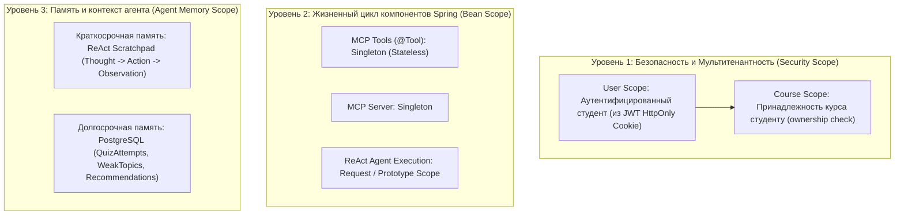
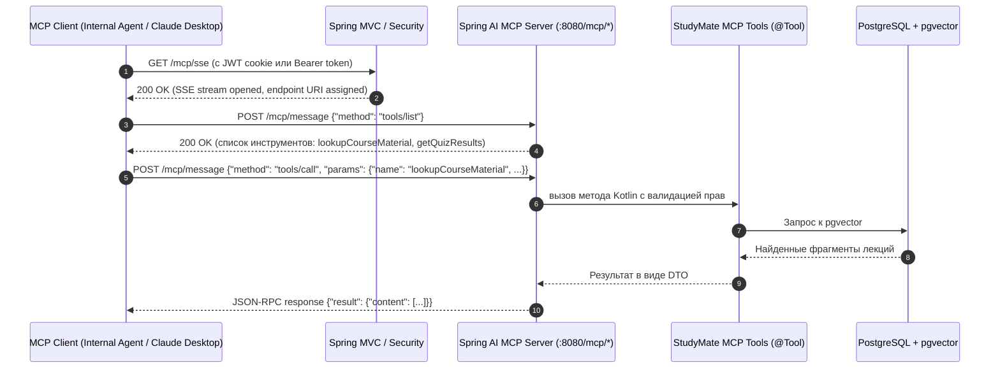
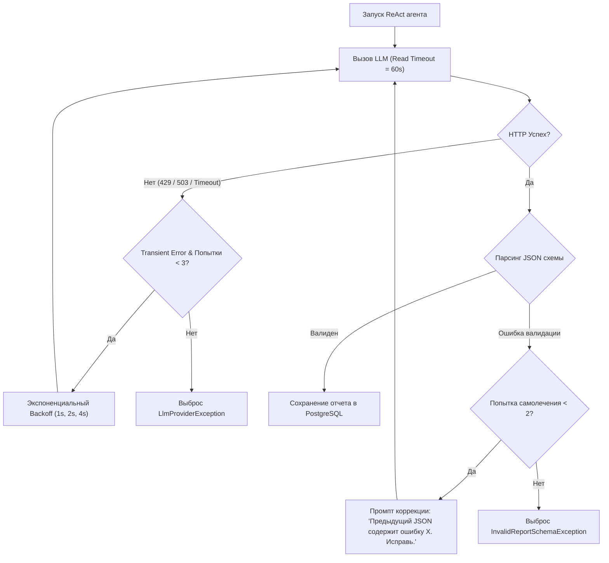

# План реализации P1: Spring AI, сервер MCP и обучающий агент (Learning ReAct Agent)

> **Приоритет: P1 (Высокий).** Реализует интеллектуальное ядро платформы: превращает StudyMate из простого поисковика в персонального AI-тьютора, который анализирует ошибки студента в тестах, находит пробелы в теории и генерирует персональный план повторения.

---

## 1. Концепция Scopes (Области видимости, изоляция и безопасность)

В архитектуре обучающего агента StudyMate понятие **Scope** делится на три критических уровня:



### 1.1. Security Scope: защита от межпользовательских утечек (IDOR)
- **Золотое правило инструментов агента:** **LLM никогда не должна передавать `userId` в аргументах `@Tool`!**
  - Если объявить инструмент как `lookupCourseMaterial(userId: UUID, courseId: UUID, query: String)`, агент под воздействием галлюцинаций или Prompt Injection может подставить `userId` другого студента.
  - Параметр `userId` **всегда извлекается на сервере** из защищенного контекста: `SecurityContextHolder.getContext().authentication` или авторизованной сессии MCP.
- **Course Scope Check:** перед любым обращением к данным инструмент выполняет проверку прав владения:
  ```kotlin
  if (!courseRepository.existsOwnedCourse(courseId, authenticatedUserId)) {
      throw CourseAccessDeniedException(courseId)
  }
  ```

### 1.2. Spring Bean Scope
- Классы с аннотациями `@Tool` объявляются как стандартные `@Component` со скоупом **Singleton**. Они должны быть полностью stateless и получать зависимости (сервисы, репозитории) через конструктор.
- Вызов ReAct-агента запускается в **Request Scope** (или внутри отдельного асинхронного таска), изолируя промежуточный контекст диалога от параллельных запросов других пользователей.

### 1.3. Agent Memory Scope
- **Short-Term (Рабочая память ReAct):** цепочка шагов (мысли модели, результаты вызова инструментов), существующая только в течение одного сеанса генерации рекомендаций.
- **Long-Term (Персистентная память):** история попыток прохождения тестов, зафиксированные слабые темы и сгенерированные проверочные задания, сохраняемые в БД PostgreSQL.

---

## 2. Подключение MCP (Model Context Protocol) напрямую к серверу

**Model Context Protocol (MCP)** — открытый протокол от Anthropic на основе **JSON-RPC 2.0**, позволяющий LLM динамически обнаруживать и безопасно вызывать инструменты сервера.

### Почему HTTP + SSE Transport, а не Stdio?
1. **Stdio (Standard Input/Output):** запускает локальный бинарник в отдельном процессе ОС. Используется десктопными клиентами (Claude Desktop, Cursor). В многопользовательской веб-системе неприменим.
2. **Streamable HTTP / SSE Transport:**
   - Spring Boot сервер StudyMate на порту `8080` регистрирует маршруты `/mcp/sse` (для получения событий) и `/mcp/message` (для отправки JSON-RPC запросов).
   - Внешние клиенты (десктопные агенты студентов, Cursor, мобильные приложения) или внутренний агент приложения общаются с сервером по стандартному протоколу HTTP/SSE.



---

## 3. Настройка Spring AI и зависимостей Gradle

В файле `backend/modules/ai/build.gradle.kts` (или в корневом `build.gradle.kts`):

```kotlin
dependencyManagement {
    imports {
        // Официальный BOM Spring AI
        mavenBom("org.springframework.ai:spring-ai-bom:1.0.0-M5")
    }
}

dependencies {
    api(project(":common"))
    implementation(project(":course"))
    implementation(project(":retrieval"))

    // 1. Стартер MCP-сервера для Spring MVC (HTTP/SSE)
    implementation("org.springframework.ai:spring-ai-starter-mcp-server-webmvc")

    // 2. Стартер ChatClient с поддержкой Tool Calling (OpenAI / Anthropic / Ollama)
    implementation("org.springframework.ai:spring-ai-openai-spring-boot-starter")

    // 3. Валидация DTO
    implementation("org.springframework.boot:spring-boot-starter-validation")
}
```

### Конфигурация в `backend/modules/app/src/main/resources/application.yml`

```yaml
spring:
  ai:
    mcp:
      server:
        webmvc:
          enabled: true
          sse-path: /mcp/sse
          message-path: /mcp/message
    openai:
      base-url: ${OPENAI_BASE_URL:https://api.groq.com/openai/v1}
      api-key: ${GROQ_API_KEY}
      chat:
        options:
          model: llama-3.3-70b-versatile
          temperature: 0.2
```

---

## 4. Реализация инструментов MCP (`@Tool`)

Инструменты инкапсулируют доступ к материалам курса и результатам тестов, обеспечивая строгий контроль безопасности.

```kotlin
package cz.cvut.fit.studymate.ai.internal.mcp

import cz.cvut.fit.studymate.course.internal.exception.CourseAccessDeniedException
import cz.cvut.fit.studymate.course.internal.repository.CourseRepository
import cz.cvut.fit.studymate.iam.api.AuthenticatedUser
import cz.cvut.fit.studymate.retrieval.api.RetrievalLookup
import cz.cvut.fit.studymate.retrieval.api.SearchResultChunk
import org.springframework.ai.tool.annotation.Tool
import org.springframework.ai.tool.annotation.ToolParam
import org.springframework.security.core.context.SecurityContextHolder
import org.springframework.stereotype.Component
import java.util.UUID

@Component
class StudyMateMcpTools(
    private val retrievalService: RetrievalLookup,
    private val courseRepository: CourseRepository,
    private val quizAttemptLookup: QuizAttemptLookupService, // сервис из модуля :quiz
) {

    @Tool(
        name = "lookupCourseMaterial",
        description = "Ищет релевантные фрагменты лекций, слайдов и конспектов курса по текстовому запросу или концепции"
    )
    fun lookupCourseMaterial(
        @ToolParam(description = "Идентификатор курса UUID") courseId: UUID,
        @ToolParam(description = "Поисковый запрос (термин, алгоритм, тема)") query: String,
    ): List<MaterialSnippetDto> {
        val userId = getAuthenticatedUserId()
        validateCourseOwnership(courseId, userId)

        val chunks = kotlinx.coroutines.runBlocking {
            retrievalService.searchCourse(courseId, userId, query, limit = 4)
        }

        return chunks.map { chunk ->
            MaterialSnippetDto(
                materialId = chunk.materialId,
                chunkIndex = chunk.chunkIndex,
                pageNumber = (chunk.metadata["pageNumber"] as? Number)?.toInt() ?: 1,
                content = chunk.text,
                relevanceScore = chunk.similarityScore,
            )
        }
    }

    @Tool(
        name = "getQuizResults",
        description = "Возвращает историю сданных студентом тестов по курсу: вопросы, выбранные ответы и темы, где были допущены ошибки"
    )
    fun getQuizResults(
        @ToolParam(description = "Идентификатор курса UUID") courseId: UUID,
    ): List<QuizMistakeRecordDto> {
        val userId = getAuthenticatedUserId()
        validateCourseOwnership(courseId, userId)

        return quizAttemptLookup.findMistakesByCourse(courseId, userId)
    }

    private fun validateCourseOwnership(courseId: UUID, userId: UUID) {
        if (!courseRepository.existsOwnedCourse(courseId, userId)) {
            throw CourseAccessDeniedException(courseId)
        }
    }

    private fun getAuthenticatedUserId(): UUID {
        val auth = SecurityContextHolder.getContext().authentication
            ?: throw IllegalStateException("Отсутствует контекст аутентификации")
        val principal = auth.principal as? AuthenticatedUser
            ?: throw IllegalStateException("Неверный тип принципала аутентификации")
        return principal.id
    }
}

data class MaterialSnippetDto(
    val materialId: UUID,
    val chunkIndex: Int,
    val pageNumber: Int,
    val content: String,
    val relevanceScore: Double,
)

data class QuizMistakeRecordDto(
    val quizId: UUID,
    val questionId: UUID,
    val topic: String,
    val questionText: String,
    val studentAnswer: String,
    val correctAnswer: String,
    val explanation: String,
)
```

---

## 5. Архитектура ReAct-агента (Learning ReAct Agent)

Агент реализует цикл **ReAct (Reasoning + Acting)**:
1. **Thought:** Модель анализирует входные данные (например, «Студент попросил проанализировать его успеваемость по курсу Алгоритмы и Структуры Данных»).
2. **Action:** Модель решает вызвать `getQuizResults(courseId)`.
3. **Observation:** Получает список ошибок (студент ошибся в вопросах про свойства красно-черных деревьев и удаление из AVL-дерева).
4. **Thought:** Модель понимает, что нужно найти точные цитаты из лекций по балансировке деревьев.
5. **Action:** Вызывает `lookupCourseMaterial(courseId, "AVL tree deletion rebalance rotation")`.
6. **Observation:** Получает слайд 18 лекции 4.
7. **Final Answer:** Синтезирует диагноз, выдержки из материалов и контрольный проверочный тест.

### Реализация агента через Spring AI `ChatClient`

```kotlin
@Service
class LearningAgentService(
    chatClientBuilder: ChatClient.Builder,
    private val mcpTools: StudyMateMcpTools,
    private val validator: Validator,
    private val objectMapper: ObjectMapper,
) {
    private val chatClient = chatClientBuilder
        .defaultSystem("""
            Ты — экспертный тьютор для студентов университета FIT ČVUT.
            Твоя задача — детально разобрать историю ошибок студента в тестах по курсу,
            сгруппировать их по конкретным темам, найти в материалах курса первоисточник
            и подготовить персональные рекомендации с контрольными вопросами.
            
            Работай строго по циклу:
            1. Вызови 'getQuizResults', чтобы понять, где студент ошибался.
            2. Для каждой проблемной темы вызови 'lookupCourseMaterial', чтобы найти точные определения из лекций.
            3. Сформируй итоговый ответ СТРОГО в формате валидного JSON.
        """.trimIndent())
        .build()

    suspend fun analyzeStudentPerformance(courseId: UUID): LearningRecommendationReport {
        // Запуск ReAct цикла с автоматическим вызовом инструментов
        val responseJson = chatClient.prompt()
            .user("Проанализируй успеваемость студента по курсу $courseId и подготовь отчет об ошибках.")
            .tools(mcpTools) // Автоматический байдинг методов @Tool
            .call()
            .content() ?: throw IllegalStateException("Пустой ответ от AI-агента")

        // Очистка от markdown-оберток (```json ... ```)
        val cleanJson = responseJson.substringAfter("```json").substringBeforeLast("```").trim()

        // Валидация и парсинг структуры
        val report = runCatching { objectMapper.readValue(cleanJson, LearningRecommendationReport::class.java) }
            .getOrElse { throw MalformedAiResponseException("Не удалось распарсить JSON отчет: ${it.message}", cleanJson) }

        validateReport(report)
        return report
    }

    private fun validateReport(report: LearningRecommendationReport) {
        val violations = validator.validate(report)
        if (violations.isNotEmpty()) {
            val message = violations.joinToString("; ") { "${it.propertyPath}: ${it.message}" }
            throw InvalidReportSchemaException("Отчет агента не прошел валидацию схемы: $message")
        }

        // Проверка бизнес-правил: каждый вопрос должен содержать ровно 4 варианта и корректный индекс
        for (topic in report.weakTopics) {
            for (q in topic.followUpQuiz) {
                require(q.options.size == 4) { "Вопрос '${q.question}' должен иметь ровно 4 варианта ответа" }
                require(q.correctOptionIndex in 0..3) { "Индекс правильного ответа должен быть от 0 до 3" }
            }
        }
    }
}
```

---

## 6. Структура отчета и DTO рекомендаций

Формат ответа строго фиксирован. Любое отклонение валидируется до сохранения в БД.

```kotlin
data class LearningRecommendationReport(
    @field:NotNull
    val courseId: UUID,
    
    @field:NotBlank
    val overallSummary: String,
    
    @field:Valid
    val weakTopics: List<WeakTopicDetail>,
)

data class WeakTopicDetail(
    @field:NotBlank
    val topicTitle: String,
    
    val severity: TopicSeverity, // CRITICAL, WARNING, INFO
    
    @field:NotBlank
    val diagnosis: String, // Почему студент ошибается (когнитивный разбор)
    
    val supportingQuizQuestionIds: List<UUID>,
    
    val lectureReferences: List<LectureReferenceDto>,
    
    @field:Valid
    val followUpQuiz: List<FollowUpQuestionDto>,
)

data class LectureReferenceDto(
    val materialId: UUID,
    val slideOrPageNumber: Int,
    val excerpt: String,
)

data class FollowUpQuestionDto(
    @field:NotBlank
    val question: String,
    
    @field:Size(min = 4, max = 4)
    val options: List<String>,
    
    @field:Min(0) @field:Max(3)
    val correctOptionIndex: Int,
    
    @field:NotBlank
    val explanation: String,
)

enum class TopicSeverity { CRITICAL, WARNING, INFO }
```

---

## 7. Отказоустойчивость: таймауты, ретраи и самовосстановление (Self-Correction)



### 1. Таймауты клиента
Для вызовов ReAct-агента устанавливается `ReadTimeout = 60` секунд (так как агент может делать несколько последовательных Tool Calls).

### 2. Bounded Retries с Resilience4j
Повторы выполняются только при сетевых задержках или лимитах провайдера (429 Too Many Requests, 502/503 Service Unavailable). При 400 Bad Request или 401 Unauthorized повторы блокируются.

### 3. Self-Correction Loop (Самолечение JSON)
Если LLM вернула JSON с синтаксической ошибкой или не соблюла схему (например, 3 варианта ответа вместо 4), сервис отправляет корректирующий промпт:
> *«Внимание: твой предыдущий ответ не прошел валидацию Bean Validation со следующей ошибкой: [индекс ответа 4 выходит за границы 0..3]. Верни исправленный JSON-объект без пояснений»*.

---

## 8. Матрица обязательных интеграционных тестов

Тесты пишутся с использованием `@SpringBootTest` и Testcontainers (PostgreSQL + pgvector).

1. **`testToolExecutionWithValidInputs`**:
   - Авторизованный пользователь вызывает `lookupCourseMaterial` для своего курса.
   - Ожидание: возвращается список фрагментов, статус 200 OK.
2. **`testToolExecutionWithInvalidInputs`**:
   - Передача несуществующего `courseId` (случайный UUID).
   - Ожидание: выбрасывается `CourseNotFoundException` (HTTP 404).
3. **`testCrossUserAccessForbidden (Защита от IDOR)`**:
   - Создаются `User_A` с курсом `Course_A` и `User_B` с курсом `Course_B`.
   - `User_B` отправляет запрос на анализ успеваемости или поиск материалов по `Course_A`.
   - Ожидание: выбрасывается `CourseAccessDeniedException` (HTTP 403 Forbidden). Данные `User_A` не утекают.
4. **`testMalformedJsonResponseHandling`**:
   - Mock LLM возвращает обрезанный JSON.
   - Ожидание: агент перехватывает ошибку, совершает bounded retry или выбрасывает типовое исключение без падения JVM.
