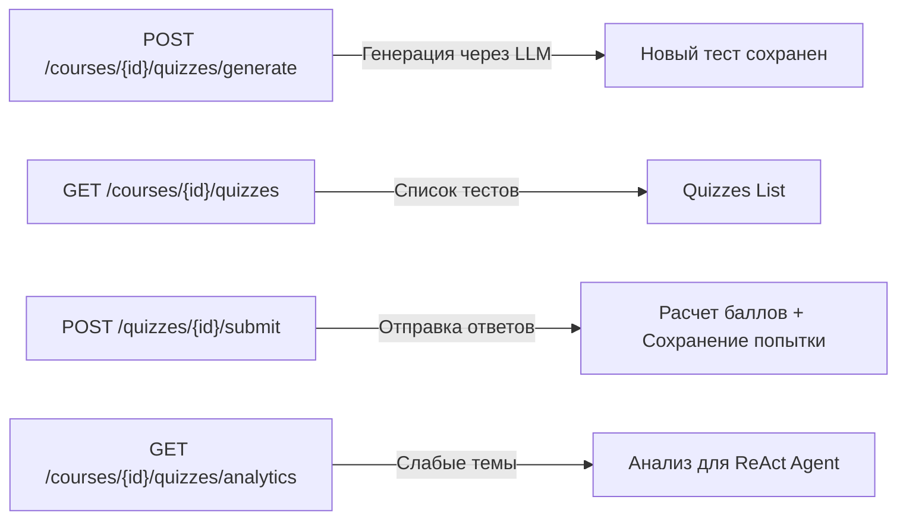

# План реализации P2: Системы тестирования (Quiz), интерактивного чата (Chat) и Real-Time уведомлений

> **Приоритет: P2 (Завершающий).** Реализует пользовательские сценарии взаимодействия: решение тестов для самопроверки, диалоговый интерфейс а-ля NotebookLLM с потоковой отдачей токенов (SSE) и кликабельными сносками, а также уведомления о ходе парсинга загруженных файлов в реальном времени.

> **Статус на 2026-11-08:** реализован первый учебный этап chat — один вопрос по курсу и один полный JSON-ответ с источниками. Его действующий контракт описан в разделе 2.0. Схемы БД, Query Rewriting, SSE и Spring AI в последующих разделах остаются проектными набросками. Метаданные страниц/слайдов и гибридный поиск из P0 также ещё не реализованы.

---

## 1. Модуль `:quiz` (Система генерации и прохождения тестов)

На текущий момент модуль [`backend/modules/quiz`](file:///Users/test/IdeaProjects/studymate/backend/modules/quiz) содержит только пустые директории с `.gitkeep`. Ниже приведена полная архитектура модуля.

### 1.1. Схема базы данных (Liquibase Changelog)

Файл: `quiz/src/main/resources/db/changelog/changes/001-create-quiz-tables.sql`

```sql
--liquibase formatted sql

--changeset studymate:quiz-001-create-quiz-tables
-- 1. Таблица тестов
CREATE TABLE quizzes (
    id uuid PRIMARY KEY DEFAULT gen_random_uuid(),
    course_id uuid NOT NULL REFERENCES courses(id) ON DELETE CASCADE,
    owner_id uuid NOT NULL REFERENCES users(id) ON DELETE CASCADE,
    title varchar(255) NOT NULL,
    description text,
    created_at timestamp with time zone NOT NULL DEFAULT now()
);

-- 2. Вопросы теста
CREATE TABLE quiz_questions (
    id uuid PRIMARY KEY DEFAULT gen_random_uuid(),
    quiz_id uuid NOT NULL REFERENCES quizzes(id) ON DELETE CASCADE,
    topic varchar(100) NOT NULL, -- Название темы (например, 'AVL Trees', 'Dijkstra')
    question_text text NOT NULL,
    explanation text NOT NULL,   -- Подробное объяснение правильного ответа
    order_index integer NOT NULL
);

-- 3. Варианты ответов к вопросам
CREATE TABLE quiz_question_options (
    id uuid PRIMARY KEY DEFAULT gen_random_uuid(),
    question_id uuid NOT NULL REFERENCES quiz_questions(id) ON DELETE CASCADE,
    option_text text NOT NULL,
    is_correct boolean NOT NULL DEFAULT false,
    order_index integer NOT NULL
);

-- 4. Попытки сдачи тестов студентом
CREATE TABLE quiz_attempts (
    id uuid PRIMARY KEY DEFAULT gen_random_uuid(),
    quiz_id uuid NOT NULL REFERENCES quizzes(id) ON DELETE CASCADE,
    user_id uuid NOT NULL REFERENCES users(id) ON DELETE CASCADE,
    score_percentage numeric(5, 2) NOT NULL,
    total_questions integer NOT NULL,
    correct_answers integer NOT NULL,
    completed_at timestamp with time zone NOT NULL DEFAULT now()
);

-- 5. Ответы студента в рамках попытки (для аналитики Learning Agent)
CREATE TABLE quiz_attempt_answers (
    id uuid PRIMARY KEY DEFAULT gen_random_uuid(),
    attempt_id uuid NOT NULL REFERENCES quiz_attempts(id) ON DELETE CASCADE,
    question_id uuid NOT NULL REFERENCES quiz_questions(id) ON DELETE CASCADE,
    selected_option_id uuid NOT NULL REFERENCES quiz_question_options(id) ON DELETE CASCADE,
    is_correct boolean NOT NULL
);

CREATE INDEX idx_quizzes_course ON quizzes(course_id);
CREATE INDEX idx_quiz_attempts_user_course ON quiz_attempts(user_id, quiz_id);
```

---

### 1.2. REST API модуля `:quiz`



#### Эндпоинты контроллера `QuizController`:
1. `POST /api/v1/courses/{courseId}/quizzes/generate`:
   - Принимает: `materialId` (опционально, если тест по одной лекции), `questionCount` (по умолчанию 5).
   - Извлекает ключевые чанки через `RetrievalService`.
   - Запрашивает у LLM генерацию вопросов и сохраняет тест в БД.
2. `POST /api/v1/courses/{courseId}/quizzes/{quizId}/submit`:
   - Принимает карту ответов студента: `{ "questionId": "selectedOptionId" }`.
   - Проверяет правильность ответов, подсчитывает процент успеха и записывает данные в `quiz_attempts` и `quiz_attempt_answers`.
   - Возвращает детальный результат с пояснениями к каждому вопросу.
3. `GET /api/v1/courses/{courseId}/quizzes/mistakes`:
   - Внутренний эндпоинт/сервис для интеграции с MCP-инструментом `getQuizResults`.

---

## 2. Модуль `:chat` (Интерактивный RAG-диалог в стиле NotebookLLM)

### 2.0. Реализованный первый этап: один вопрос и полный JSON-ответ

```http
POST /api/v1/courses/{courseId}/chat
Content-Type: application/json
Cookie: access_token=<JWT>

{
  "question": "Что означает атомарность транзакции?"
}
```

`courseId` берётся из URL, идентификатор пользователя — из проверенного principal через `@AuthenticationPrincipal`. Поле `userId` не является частью запроса и не может подменить пользователя. Для `ChatRequest.question` сначала проверяется JSON-тип локальным `ChatQuestionDeserializer`: допускается только строка. Числа, boolean, массивы, объекты и null дают `400`; строка `"42"` остаётся допустимой. Пустые и пробельные строки затем отклоняются через `@Valid` и `@field:NotBlank`. Настройки Jackson остальных API не меняются.

Контроллер находится в `chat.internal.controller`, DTO — в `chat.internal.dto`, сервис — в `chat.internal.service`. Публичный интерфейс chat пока не требуется: других межмодульных потребителей нет.

`ChatService.ask` вызывает `RetrievalLookup.searchCourse` с лимитом 5. Retrieval проверяет вопрос, наличие курса и владельца, получает embedding и ищет фрагменты. Найденные чанки в исходном порядке преобразуются в `ChatSource` с обозначениями `S1`, `S2`, затем в `ContextChunk`. `RagChatPrompts.buildMessages` добавляет инструкции, контекст и вопрос; `LlmClient.complete` из существующей фабрики возвращает текст ответа. Фабрика уже добавляет ретраи, поэтому повторные попытки в chat не дублируются.

Пример формы ответа `200`:

```json
{
  "answer": "Транзакция выполняется целиком либо не выполняется вовсе. [S1]",
  "sources": [
    {
      "source": "S1",
      "chunkId": "00000000-0000-0000-0000-000000000001",
      "materialId": "00000000-0000-0000-0000-000000000002",
      "chunkIndex": 7,
      "text": "Atomicity ensures all-or-nothing execution."
    }
  ]
}
```

`source` — обозначение в контексте одного ответа, а `chunkIndex` — исходный индекс чанка в материале. Список `sources` содержит фрагменты, переданные модели; проверка того, что модель верно использовала каждую ссылку, пока отсутствует. Номера страниц, названия материалов и другие отсутствующие метаданные не добавляются.

Если поиск вернул пустой список, сервис не вызывает LLM и возвращает `200` с `sources: []` и выбранным сообщением `Not found an answer for course: <courseId>, question: <question>`. Если чанки есть, но информации недостаточно, существующий промпт требует сообщить об этом вместо догадки. Наличие ближайших векторов само по себе не гарантирует достаточность контекста.

`ChatExceptionHandler` ограничен `ChatController`. Ошибки имеют существующий формат `ErrorResponse` с полем `message`:

| Код | Причина | Сообщение / тело |
| --- | --- | --- |
| 400 | Пустой или состоящий из пробелов вопрос | Ошибка валидации `question` |
| 400 | Некорректный JSON, отсутствующий, null или нестроковый `question` | `Invalid JSON body: provide a string question` |
| 400 | Некорректный UUID курса | `Invalid value for parameter 'courseId'` |
| 400 | `InvalidRetrievalRequestException` | Сообщение проверки retrieval |
| 403 | Чужой курс | `Access to course <courseId> is denied` |
| 403 | Нет действительной access-token cookie | Ответ существующего Spring Security; тело может отсутствовать |
| 404 | Курс отсутствует | `Course not found: <courseId>` |
| 415 | Тело передано с неподдерживаемым Content-Type | Стандартный ответ Spring MVC |
| 502 | Ошибка embedding-провайдера | `Embedding generation failed` |
| 502 | Ошибка LLM или пустой/пробельный ответ | `Answer generation failed` |

Сообщения ошибок провайдеров не передаются клиенту. Ответ `ChatResponse` сериализуется Spring/Jackson; модель генерирует текст, а не JSON-контракт HTTP API.

Проверки первого этапа находятся в двух классах. `ChatServiceTest` проверяет поведение сервиса. В `ChatControllerTest` основные HTTP-сценарии используют мок `ChatService`; один успешный сценарий проходит через настоящий сервис и `RagChatPrompts`, проверяя передачу вопроса и пользователя, сообщения LLM и итоговый JSON с источниками `S1`/`S2`, исходными индексами, идентификаторами и текстом. В этом сценарии retrieval и LLM мокированы, principal задаётся тестовым resolver; реальный JWT, Spring DI и внешняя LLM им не проверяются. Существующие тесты IAM отдельно проверяют JWT-фильтр и асинхронное завершение suspend-контроллера. CI по-прежнему запускает `:chat:test`.

Первый этап не создаёт миграций или записей истории и не добавляет endpoint для материала, SSE, Query Rewriting, Spring AI или MCP. Для локальной проверки при уже сгенерированных jOOQ-классах можно выполнить из `backend`:

```bash
./gradlew :chat:test :iam:test --tests '*JwtAsyncDispatchTest' :app:compileKotlin -x generateJooq -x liquibaseUpdate
```

### 2.1. Схема базы данных истории чата

Файл: `chat/src/main/resources/db/changelog/changes/001-create-chat-tables.sql`

```sql
--liquibase formatted sql

--changeset studymate:chat-001-create-chat-tables
-- Сессии чатов (могут быть привязаны ко всему курсу или к конкретной лекции)
CREATE TABLE chat_sessions (
    id uuid PRIMARY KEY DEFAULT gen_random_uuid(),
    course_id uuid NOT NULL REFERENCES courses(id) ON DELETE CASCADE,
    material_id uuid REFERENCES materials(id) ON DELETE SET NULL,
    user_id uuid NOT NULL REFERENCES users(id) ON DELETE CASCADE,
    title varchar(255) NOT NULL,
    created_at timestamp with time zone NOT NULL DEFAULT now(),
    updated_at timestamp with time zone NOT NULL DEFAULT now()
);

-- Сообщения внутри чата
CREATE TABLE chat_messages (
    id uuid PRIMARY KEY DEFAULT gen_random_uuid(),
    session_id uuid NOT NULL REFERENCES chat_sessions(id) ON DELETE CASCADE,
    role varchar(20) NOT NULL, -- 'USER', 'ASSISTANT', 'SYSTEM'
    content text NOT NULL,
    citations jsonb DEFAULT '[]'::jsonb, -- Список ссылок на слайды/страницы
    created_at timestamp with time zone NOT NULL DEFAULT now()
);

CREATE INDEX idx_chat_sessions_user_course ON chat_sessions(user_id, course_id);
CREATE INDEX idx_chat_messages_session ON chat_messages(session_id, created_at);
```

---

### 2.2. Query Reformulation (Переписывание запросов в многошаговом диалоге)

Если студент задает вопрос:
- Шаг 1: *«Что такое красно-черное дерево?»*
- Шаг 2: *«Каковы его 5 базовых свойств?»*

Если искать в pgvector по строке *«Каковы его 5 базовых свойств?»*, векторный поиск не найдет термин «красно-черное дерево».

**Механизм переписывания (Query Rewriter):**
Перед обращением к `RetrievalService` LLM получает последние 3–5 сообщений диалога и формулирует **автономный поисковый запрос (Standalone Query)**.

```kotlin
@Component
class QueryRewriter(private val chatClient: ChatClient) {

    fun rewriteQuery(history: List<ChatMessage>, currentQuestion: String): String {
        if (history.isEmpty()) return currentQuestion

        val prompt = """
            Учитывая историю предыдущего диалога студента и его новый вопрос,
            сформулируй автономный поисковый запрос для поиска по материалам лекций.
            Запрос должен содержать все необходимые термины и ключевые слова.
            НЕ отвечай на вопрос, верни ТОЛЬКО текст поискового запроса.
            
            История диалога:
            ${history.takeLast(4).joinToString("\n") { "${it.role}: ${it.content}" }}
            
            Новый вопрос: $currentQuestion
        """.trimIndent()

        return chatClient.prompt().user(prompt).call().content()?.trim() ?: currentQuestion
    }
}
```

---

### 2.3. Потоковая генерация через Server-Sent Events (SSE)

Для обеспечения пользовательского опыта уровня NotebookLLM ответ LLM транслируется посимвольно/пословно по протоколу SSE.

```kotlin
@RestController
@RequestMapping("/api/v1/courses/{courseId}/chats")
class ChatStreamController(
    private val chatService: ChatService,
    private val retrievalService: RetrievalLookup,
    private val queryRewriter: QueryRewriter,
    private val streamingChatClient: ChatClient,
) {

    @GetMapping("/{sessionId}/stream", produces = [MediaType.TEXT_EVENT_STREAM_VALUE])
    fun streamChat(
        @PathVariable courseId: UUID,
        @PathVariable sessionId: UUID,
        @RequestParam question: String,
        @AuthenticationPrincipal user: AuthenticatedUser,
    ): SseEmitter {
        val emitter = SseEmitter(60_000L) // 60 секунд таймаут

        CoroutineScope(Dispatchers.IO).launch {
            try {
                // 1. Проверка прав владения чатом
                chatService.validateSessionOwnership(sessionId, user.id)

                // 2. Получение истории и переписывание запроса
                val history = chatService.getMessageHistory(sessionId, limit = 6)
                val standaloneQuery = queryRewriter.rewriteQuery(history, question)

                // 3. Поиск релевантных фрагментов в pgvector
                val chunks = retrievalService.searchCourse(courseId, user.id, standaloneQuery, limit = 4)

                // 4. Отправка клиенту найденных цитат (первое SSE-событие)
                val citations = chunks.map { chunk ->
                    CitationEvent(
                        chunkIndex = chunk.chunkIndex,
                        pageNumber = (chunk.metadata["pageNumber"] as? Number)?.toInt() ?: 1,
                        materialTitle = chunk.metadata["materialTitle"]?.toString() ?: "Lecture",
                        snippet = chunk.text.take(150),
                    )
                }
                emitter.send(SseEmitter.event().name("citations").data(citations))

                // 5. Потоковый вызов LLM
                val fullResponse = StringBuilder()
                val promptMessages = RagChatPrompts.buildMessages(
                    chunks.map { ContextChunk(it.metadata["materialTitle"].toString(), it.text) },
                    question
                )

                streamingChatClient.prompt()
                    .messages(promptMessages)
                    .stream()
                    .chatResponse()
                    .collect { responseChunk ->
                        val token = responseChunk.result?.output?.content ?: ""
                        fullResponse.append(token)
                        emitter.send(SseEmitter.event().name("token").data(token))
                    }

                // 6. Сохранение сообщений в БД
                chatService.saveUserAndAssistantMessages(sessionId, question, fullResponse.toString(), citations)
                emitter.send(SseEmitter.event().name("done").data("[DONE]"))
                emitter.complete()
            } catch (e: Exception) {
                emitter.completeWithError(e)
            }
        }

        return emitter
    }
}
```

---

## 3. Real-Time стриминг статусов парсинга документов

### Проблема:
В [`StatusEventRelay.kt`](file:///Users/test/IdeaProjects/studymate/backend/modules/ingestion/src/main/kotlin/cz/cvut/fit/studymate/ingestion/internal/notification/StatusEventRelay.kt) статус парсинга отправляется в канал Redis `material-status:user:$ownerId`, однако веб-клиент не имеет способа подписаться на эти события и вынужден бесконечно опрашивать сервер (polling).

### Решение: SSE-контроллер уведомлений

Создается контроллер в модуле `:course` (или `:ingestion`), слушающий события из Redis и транслирующий их в открытый SSE-поток браузера:

```kotlin
@RestController
@RequestMapping("/api/v1/materials")
class MaterialStatusNotificationController(
    private val redisMessageListenerContainer: RedisMessageListenerContainer,
) {

    @GetMapping("/status/stream", produces = [MediaType.TEXT_EVENT_STREAM_VALUE])
    fun subscribeToMaterialStatus(
        @AuthenticationPrincipal user: AuthenticatedUser,
    ): SseEmitter {
        val emitter = SseEmitter(180_000L) // 3 минуты
        val channelTopic = ChannelTopic("material-status:user:${user.id}")

        val listener = MessageListener { message, _ ->
            try {
                emitter.send(SseEmitter.event().name("status-update").data(String(message.body)))
            } catch (e: Exception) {
                emitter.complete()
            }
        }

        redisMessageListenerContainer.addMessageListener(listener, channelTopic)

        emitter.onCompletion { redisMessageListenerContainer.removeMessageListener(listener) }
        emitter.onTimeout { 
            redisMessageListenerContainer.removeMessageListener(listener)
            emitter.complete()
        }

        return emitter
    }
}
```

---

## 4. Чек-лист готовности модулей P2

- [x] Реализован первый RAG-ответ по курсу: полный JSON с источниками, обработка ошибок и тесты.
- [ ] Создан Liquibase changelog для таблиц `quizzes`, `quiz_questions`, `quiz_attempts`, `quiz_attempt_answers`.
- [ ] Реализован сервис расчета результатов теста и сохранения аналитики ошибок.
- [ ] Создан Liquibase changelog для таблиц `chat_sessions` и `chat_messages`.
- [ ] Реализован шаг Query Reformulation перед вызовом RAG.
- [ ] Настроен SSE-эндпоинт с передачей токенов и цитат слайдов в реальном времени.
- [ ] Настроен SSE-эндпоинт подписки на события изменения статуса загруженных материалов из Redis.
